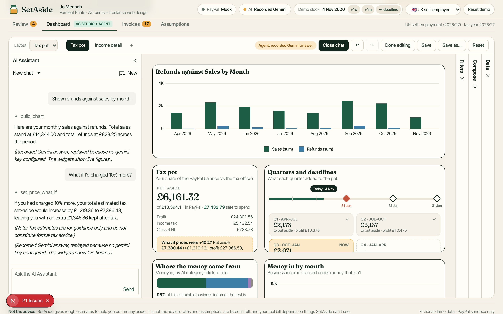
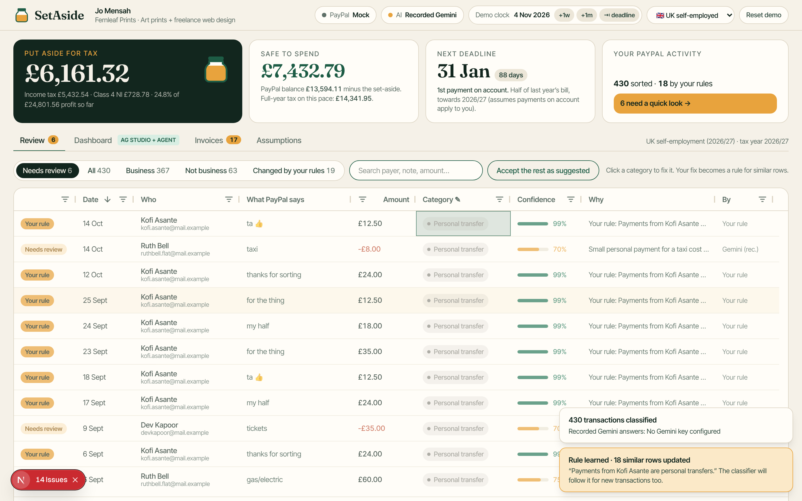

# SetAside

**Know what to put aside before the tax bill does.**

People who get paid through PayPal on the side (sellers, freelancers, creators) mix shop sales and client work with pizza money, flat bills and birthday gifts in one account. They never know how much of the balance is really theirs, and the tax deadline comes as a shock. SetAside reads the PayPal account (Transaction Search, Balances, Invoicing), and an AI agent sorts every transaction into sale, client payment, refund, fee, personal transfer or reimbursement, with a confidence score and a one-line reason. You fix the few rows it isn't sure about, and each fix becomes a rule that re-sorts similar rows. From there SetAside works out **the tax to put aside, what's safe to spend and when the next deadline is**, under UK or US self-employment rules. The figures sit in an AG Studio dashboard that you can question in plain English ("show refunds against sales by month", "what if I'd charged 10% more?"); the agent answers by building and editing widgets live.



> **Not tax advice.** SetAside gives rough estimates to help you put money aside. Every rate and assumption is listed in [`lib/tax/presets.ts`](lib/tax/presets.ts) and on the Assumptions tab.

---

## Judge quickstart

**Hosted demo:** `https://setaside.onrender.com` *(placeholder; it's on Render's free plan, so the first load can take about a minute while it wakes up)*

**Run it locally in mock mode. No accounts or keys needed:**

```bash
npm install && npm run dev
```

Open http://localhost:3000. Requires **Node.js 22.12 or later** (the AI SDK, `better-sqlite3` and Vitest need it). With no keys, the status chips read **PayPal: Mock** and **AI: Recorded Gemini**. The PayPal adapter serves fixtures shaped exactly like the documented API responses, and the AI replays answers recorded from real Gemini runs.

### The two-minute story

The counts below are from mock mode, where the replayed answers are fixed. Live Gemini files a few rows differently on each run (typically 21–27 to review), so the exact numbers change.

1. **Classify 430 transactions with AI** (top right). The year sorts itself in a couple of seconds, and 22 rows land in *Needs review*.
2. In **Review**, change Kofi Asante's 10 April payment from *Sale* to **Personal transfer**. SetAside learns the rule *"Payments from Kofi Asante are personal transfers"* and 18 similar rows flash as they update.
3. Change Ruth Bell's *gas/electric* payment to **Reimbursement**. Her other bill repayments follow (6 rows).
4. **Dashboard → ✦ Ask SetAside → "Refunds vs sales by month"**. The agent builds the chart at the top of the page. Then ask **"What if I'd charged 10% more?"** and the tax pot and deadline strip redraw with a what-if line.
5. **Invoices**: raise a PayPal invoice for a client who paid without one, then play the client and pay Jo with the PayPal button.
6. **Demo clock → ⇥ deadline** jumps to two weeks before 31 January. New PayPal activity arrives, gets classified (your rules first), and you see the figure to put aside.



**Reset demo** (top right) starts over. The preset switch flips to the US self-employment scenario (USD, quarterly estimated tax).

---

## How PayPal is used

| Where | PayPal API | How |
|---|---|---|
| Pulling the year | **Transaction Search** `GET /v1/reporting/transactions` | [`@paypal/paypal-server-sdk`](https://www.npmjs.com/package/@paypal/paypal-server-sdk) `TransactionSearchController.searchTransactions`. The API allows at most 31 days per query, so [`lib/paypal/sync.ts`](lib/paypal/sync.ts) splits the range into windows, pages each one (`page`/`total_pages`) and de-duplicates by `transaction_id`. **The demo year itself is seeded history** served by the mock adapter in the exact Transaction Search shape, because a sandbox can't hold a back-dated year. In live mode the last 90 days of real sandbox activity are searched and merged on top (see *Real vs simulated*). |
| Balance | **Balances** `GET /v1/reporting/balances` | `TransactionSearchController.searchBalances`. In live mode the sandbox account's real balance is shown under *Safe to spend*, and the call doubles as the health check. Safe to spend itself uses the demo history's running balance (PayPal's `ending_balance` on the last seeded transaction), so it matches the seeded year. |
| Work paid without an invoice | **Invoicing v2** `POST /v2/invoicing/invoices`, `POST …/{id}/payments` | The server SDK has no Invoicing controller, so this is REST with a client-credentials token (the boilerplate's pattern): create the invoice, then record the PayPal payment against it so it reads as paid. An explicit state machine drives it ([`lib/invoice-flow.ts`](lib/invoice-flow.ts)). |
| A client pays | **PayPal JS SDK buttons** + **Orders v2** | The buttons on the Invoices tab call our server, which creates and captures the order with `OrdersController`. Transaction Search can lag by up to three hours, so the capture is recorded straight away and reconciled when Search catches up. Live order creation is verified against the sandbox; completing a live payment needs a sandbox buyer login in PayPal's popup, so the live capture step hasn't been run end to end (the mock button runs the same flow). |
| Following one payment | **Payments v2** `GET /v2/payments/captures/{id}` | [`scripts/sandbox-lifecycle.ts`](scripts/sandbox-lifecycle.ts) takes a real sandbox payment through capture lookup → Transaction Search → AI → Invoicing → tax. [`docs/sandbox-lifecycle.md`](docs/sandbox-lifecycle.md) is a real run for `3KV701938H745371C`. |

Every external service sits behind an adapter with a **live** and a **mock** implementation that return the same, documented, snake_case shapes ([`lib/paypal/types.ts`](lib/paypal/types.ts)). Live is used when keys are set and PayPal answers; otherwise mock, and the chip says which. The mock enforces the same rules as the real API: ranges over 31 days are rejected, results are paged, and the last three hours are hidden.

## Real vs simulated

**Simulated in every mode:** Jo Mensah, her business, her customers and her year of transactions are fictional. The year is seeded data served in PayPal Transaction Search's exact response format, because a sandbox account can't hold a back-dated year. Everything below is about which *calls* are real.

**With the current sandbox app and Gemini key (checked 12 November 2026):**

| Part | Status | What actually happens |
|---|---|---|
| PayPal sign-in (OAuth) | ✅ real | The keys are accepted by the PayPal sandbox. |
| PayPal JS SDK buttons + Orders v2 | ✅ real (orders) · ⚠️ capture not run | Real sandbox orders are created. Completing a payment needs a sandbox buyer to log in in PayPal's popup, which hasn't been done end to end. |
| Transaction Search | ⚠️ simulated | The app answers 403: the **Transaction search** permission isn't enabled, so the demo history is all you see. The paging code was verified live on 5 Nov with an earlier app. |
| Balances | ⚠️ simulated | 403, same permission. Safe to spend uses the demo history's balance. |
| Invoicing | ⚠️ simulated | 403: the **Invoicing** permission isn't enabled. Invoices are created by the mock adapter, and the app says so. Never verified live. |
| Gemini classifier and agent | ⚠️ recorded | The order is `gemini-3.8-flash` → `gemini-2.5-flash` → recorded answers. On 12 Nov, 3.8-flash was overloaded or over quota, and Google has retired 2.5-flash for new keys, so the app replayed answers recorded from real Gemini runs. The chip says "Recorded Gemini". Live classification and the live agent *were* verified on 5 Nov with an earlier key (`gemini-3.6-flash`). |
| Rules, tax maths, AG Grid, AG Studio widgets | ✅ real | All run in the app itself, whatever mode PayPal and Gemini are in. |

**With no keys at all**, everything PayPal- and Gemini-shaped is mock or recorded, and the whole demo story still runs. The status chips always show which mode each part is in.

To make Transaction Search, Balances and Invoicing real, follow *Live sandbox setup* below.

**Hosted demo caveat:** the app is single-tenant. Everyone who opens a deployment shares one SQLite database and one demo clock, and the API routes have no authentication, so one visitor's **Reset demo** resets it for everyone. `/api/agent` is rate-limited to 8 Gemini calls a minute but is otherwise open. That's fine for a judged demo; it isn't production-ready.

## How AI is used

**1. The classifier agent** ([`lib/ai/classify.ts`](lib/ai/classify.ts)). Gemini, through the Vercel AI SDK (`@ai-sdk/google`), reads batches of 120 transactions and must answer through a single tool call, `record_classifications`, whose zod schema fixes the six categories, a 0–1 confidence and a one-line reason. No free text is parsed. The prompt asks for calibrated doubt (friends paying with goods-and-services, a client's "expenses" payment, a flatmate's bill money), and anything under 80% goes to the review queue. The person's corrections ride along as rules, so new rows follow them.

**2. Corrections become rules** ([`lib/rules.ts`](lib/rules.ts)). A fix records what made the row recognisable (the payer, plus a telling word such as "electric" or "expenses") and is applied straight away to every similar row the person hasn't decided themselves. A [review state machine](lib/review.ts) guarantees automation never overwrites a person.

**3. A custom agent in AG Studio's Agent Framework** ([`app/studio/agent.ts`](app/studio/agent.ts)). "SetAside analyst" runs on Studio's **Direct LLM Runner** through our own **Gemini `AgLlmAdapter`** ([`app/studio/gemini-adapter.ts`](app/studio/gemini-adapter.ts)), which posts each round to [`/api/agent`](app/api/agent/route.ts) so the key stays on the server. The agent has Studio's own page tools (`view_page`, `position_widget`, `remove_widget`) plus custom tools defined with `api.defineAiTool`:
- `build_chart` / `edit_chart` build or edit a fully configured chart in one call
- `set_price_what_if` redraws the tax pot and deadline strip widgets with a price-change scenario
- `get_tax_position` returns the exact figures from the tax engine, so the model never does tax maths
- `query_totals` and `add_setaside_widget`

**Free-tier discipline.** Calls go through a local rate limit and a SQLite cache, then try `gemini-3.8-flash` (the newest Flash), then `gemini-2.5-flash`, moving on after a rate limit, an overload, a retired model or a 45-second timeout ([`lib/ai/model.ts`](lib/ai/model.ts)). If all of them fail, SetAside replays responses recorded from real Gemini runs ([`fixtures/ai`](fixtures/ai)), and the status chip and the chat say so. A deterministic classifier is the last resort.

## AG Grid and AG Studio

- **Review grid** (AG Grid Enterprise): editable rich-select category column, confidence bars, rule flashes, set filters, quick filter, status bar.
- **AG Studio dashboard** with a custom theme built from SetAside's design tokens ([`app/studio/theme.ts`](app/studio/theme.ts)) and **three custom widgets** registered with `createWidgets`, each with a form, AI metadata, filter support and integer-only maths:
  - **Tax pot gauge**: a jar filled to the tax office's share of the PayPal balance, with set-aside, safe to spend, the tax breakdown and a what-if line.
  - **Quarterly deadline strip**: the tax year as quarters, showing the set-aside each one added, with deadlines pinned on a timeline and a "today" marker on the demo clock.
  - **Income by category**: a proportional bar plus a list with the AI's average confidence. Clicking a category **cross-filters** the page.
- **Saved layouts**: Save, Save as…, a layout picker, pages, undo/redo and edit mode.
- The **custom agent** above, in Studio's own chat panel, with prompt starters.

## Tax presets

[`lib/tax/presets.ts`](lib/tax/presets.ts) is one config file of clearly labelled rates, thresholds, deadlines and simplifications:
- **UK self-employment 2026/27**: personal allowance, 20/40/45% bands, Class 4 NI at 6% and 2%, the £1,000 trading allowance, and payment-on-account deadlines.
- **US self-employment 2026 (single filer)**: SE tax at 15.3% on 92.35% of profit up to the wage base, 2026 federal brackets and standard deduction, half of SE tax deducted, and 1040-ES quarterly deadlines.

Side profit is taxed on top of an editable salary, so your marginal rate applies. Money is **integer minor units** in storage and in all tax maths ([`lib/money.ts`](lib/money.ts)): PayPal's decimal strings are parsed digit by digit, rates are basis points, and rounding is explicit. AG Studio charts need plain numbers, so the dashboard's visible money fields are major units for display; the tax widgets read hidden integer fields instead.

## Live sandbox setup

1. Create a sandbox REST app at [developer.paypal.com](https://developer.paypal.com/dashboard/applications/sandbox). Enable **Transaction search** for live Transaction Search and Balances, and **Invoicing** for live invoices. Without the Invoicing permission, SetAside falls back to mock invoices and says so.
2. Get a free Gemini key at [aistudio.google.com/apikey](https://aistudio.google.com/apikey).
3. Copy the example env file and fill it in:

   ```bash
   cp .env.example .env.local
   ```

   Then run `npm run dev`. The chips should read **PayPal: Sandbox live** and **AI: Gemini …**.
4. Optional: follow a real sandbox payment end to end:

   ```bash
   npm run sandbox:lifecycle -- <transaction id>
   ```

Deploy with [`render.yaml`](render.yaml) (a Render Blueprint, free plan), then set the same variables in Render.

## Scripts

```bash
npm run dev          # Next.js dev server (seeds SQLite on first request)
npm run build        # production build
npm run start        # serve the build
npm run lint         # eslint
npm run typecheck    # next typegen + tsc
npm test             # vitest: money, tax engine, state machines, AI tool schemas, PayPal paging
npm run fixtures     # regenerate fixtures/paypal from the seeded scenario
npm run record-ai    # re-record Gemini classifications for the scenario (uses your quota)
```

## How it's built

The five files that matter most, and the decisions behind them, are in [`docs/ARCHITECTURE.md`](docs/ARCHITECTURE.md).

```
lib/money.ts              integer minor-unit money: parse, apply basis points, format
lib/tax/presets.ts        UK + US presets: every rate, threshold, deadline and assumption
lib/tax/engine.ts         profit, tax, set-aside, safe-to-spend, quarterly accrual (pure)
lib/paypal/               adapters (live SDK/REST + mock fixtures), 31-day window paging
lib/ai/                   classifier (zod tool call), model chain + rate limit, agent turn server
lib/rules.ts, review.ts   corrections → rules; review state machine
lib/service.ts            orchestration over SQLite (better-sqlite3): sync, classify, correct, invoice
lib/seed/generate.ts      the deterministic fictional scenario
app/ui/                   shell, review grid, invoices + PayPal buttons, assumptions
app/studio/               AG Studio: data, theme, custom widgets, Gemini adapter, agent, layouts
scripts/                  fixtures, AI recording, sandbox lifecycle
```

Next.js (App Router) and TypeScript, one Node service. Browser-only libraries (AG Grid, AG Studio, the PayPal JS SDK) load with `dynamic(..., { ssr: false })`.

## Credits

Built on PayPal's **[AG Studio hackathon boilerplate](https://github.com/paypaldev/hackathon-paypal-ag-grid-boilerplate)**. SetAside reuses its PayPal REST patterns (client-credentials token caching, retries, paging), its AG Studio shell structure (theme-from-tokens, saved reports, page handling), its pinned versions (`ag-studio` 3.0.0, `ag-grid` 36.2.0, Next.js 16.3.6), and the shape of its AG Studio LLM adapter, which SetAside adapts from OpenAI to Gemini.

All people, businesses and emails in the demo are fictional. MIT licensed, see [LICENSE](LICENSE).
